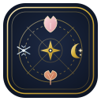

<p align="center">
  
</p>

<h1 align="center">四時詩籤・謐夜塔羅</h1>
<p align="center"><strong>THE SEASONAL ORACLE</strong></p>

> 一座專為女性築起的四季心靈花園與詩意互動塔羅空間。  
> 秉持獨立精品雜誌（Editorial Magazine）與手工紙藝（Haute Papeterie）的美學規格，結合 22 張高訂三層浮雕矢量牌面、四季純音樂與觸感微聲響、動態散文詩合成引擎與雙比例高畫質籤詩明信片，在流轉的微光之中，溫柔傾聽靈魂深處的迴響。
>
> 線上體驗：[https://wu0308.github.io/four-seasons-tarot/](https://wu0308.github.io/four-seasons-tarot/)

---

## 核心體驗與特色機能 (Core Experience)

### 1. 四季光影調色盤與自然畫布 (Atmospheric Seasons)
全站由 CSS Variables 驅動並以 `0.8s ease` 平滑過渡色彩、窗影光斑（Dappled Window Light）、極光景深（Ambient Aurora Blobs）與有機粒子畫布（`requestAnimationFrame`）：

| 季節主題 | 英文刊號與意象 | 主調色 | 動態粒子與典藏牌背設計 |
| :--- | :--- | :--- | :--- |
| **春・初綻** | `VOL. I ・ VERNAL BLOOM` | `#FAF8F5`、`#F7E9E8`、`#DCE2D6` | 三維翻滾缺口櫻花瓣與微光粉塵；牌背為櫻花五瓣浮雕與春分星軌 |
| **夏・仲夜** | `VOL. II ・ MIDNIGHT AURA` | `#121A2B`、`#182238`、`#D4AF37` | 四角閃爍星芒與徑向仲夏流螢；牌背為深海六芒星輪與潮汐環飾 |
| **秋・暮光** | `VOL. III ・ AMBER TWILIGHT` | `#F4EFEA`、`#E8DDD3`、`#C87A5B` | 扇形銀杏落葉與午後六角光散景；牌背為落葉葉脈與日蝕平衡儀 |
| **冬・初雪** | `VOL. IV ・ SILENT FROST` | `#E6ECEF`、`#D7E1E6`、`#1E2F2E` | 景深柔焦微雪與六角對稱冰晶；牌背為六角雪晶星象鎖與菱格冰花 |

### 2. 三層浮雕與星象雕版卡面美學 (Card Art & 3D Optics)
* **22 張大阿爾克那與 4 款卡背矢量圖庫**：由 [`scripts/generate_luxury_card_svgs.py`](scripts/generate_luxury_card_svgs.py) 生成至 [`js/card-svgs.js`](js/card-svgs.js)，採「星象天文刻度底稿 ＋ 雙透光度浮雕塊面剪影 ＋ 新藝術拱門邊飾」三層雕版設計。
* **真金漸層與 3D 游標視差反光**：翻開牌面時觸發 `svgGoldDraw` 與 `svgCameoReveal` 金線手繪顯影動畫，隨滑鼠與觸控視差傾斜卡片並折射即時金屬光斑（`.card-specular-glare`）。
* **微距放大賞析燈箱**：點擊階段三已翻開卡牌、階段四縮圖或圖鑑內卡片，皆可開啟大型微距燈箱細賞紋理，並於燈箱內自由切換對照「正位 / 逆位」全文釋義。

### 3. 沉浸式儀式流程 (Four-Act Journey)
1. **Act I ・ 季節・意圖・心語寄託 (`ACT I ・ SEASON & INTENTION`)**：
   * 選擇四大人生心境向度：**情感與羈絆（`01 / AFFECTION`）**、**自我與靈魂（`02 / SOLITUDE`）**、**事業與方向（`03 / HORIZON`）**、**今日的溫柔指引（`04 / EPHEMERA`）**。
   * 支援雙牌陣切換：**【三牌・時光陣】**（溯源・當下・微光）與**【單牌・流光鏡】**（當下定格・每日指引）。
   * 選填「心語寄託」私密輸入框，寫下心底未竟之問，於冥想、解讀、明信片與手札中全程迴響。
2. **Act II ・ 靜心・星軌吐納・波浪感應抽牌 (`ACT II ・ STILLNESS & RITUAL`)**：
   * **星軌呼吸引導**：三層旋轉星盤配合 4-4-4 柔和節律光環與四季禱詞，帶領身心沉澱；點擊展開牌陣時伴隨微風音效與畫面漣漪柔和轉場。
   * **祭壇席位槽與波浪盲選牌弧**：上方視覺化呈現【溯源 / 當下 / 微光】或【流光】席位預備狀態；下方 14 張圓弧扇面背卡支援滑鼠與觸控橫向滑動「共鳴波浪感應」，即時浮現席位羅馬編號與直覺耳語；亦支援隨時點擊「重新洗牌・再感應」再度洗鍊牌陣。
3. **Act III ・ 三維翻牌與命運揭示 (`ACT III ・ THE REVELATION`)**：
   * 3D 空間翻轉揭示正位或逆位（逆位圖騰精準旋轉 180 度），同步點亮對應的秘儀收藏印記。
4. **Act IV ・ 多維度動態詩學與手札隨筆**：
   * 依據牌陣模式（單牌 / 三牌）、四季自然隱喻、四大主題與正逆位組合弧線（破曉型、救贖型、內省型、深潛淬鍊型），由 [`buildSynthesizedEssay()`](js/app.js) 即時編織不落俗套的現代散文詩。
   * 支援現場書寫「手札隨筆」批註並封存至本地瀏覽器儲存空間。

### 4. 雙通道純音樂與 Web Audio API 紙張微音效 (Audio Architecture)
* **雙通道交叉淡入淡出 BGM 引擎**（[`js/audio.js`](js/audio.js)）：搭載 `assets/audio/` 四季專屬純音樂，切換季節時以 `0.8s` 淡出與 `1.0s` 淡入無縫過渡，並提供「微・適・沁」三段音量記憶。
* **觸感紙藝微聲響合成器**：免外部音效檔，透過 Web Audio API 粉紅噪聲帶通濾波與柔和泛音即時合成「展開牌陣微風聲」、「扇形洗牌棉紙摩挲聲」、「指尖滑過牌緣的微觸音」、「抽牌落座晶體和弦」與「翻牌紙頁輕拂聲」，並嚴格遵守靜音開關設定。

### 5. 雙比例精裝明信片、時光手札與秘儀典藏圖鑑
* **雙比例高畫質籤詩明信片**：結合 `html2canvas` 一鍵將本次占卜的迷你牌陣圖案、心語、季節寄語與手札隨筆凝印為 PNG 圖檔，支援即時切換：
  * **`3:4` 典藏書籤版**（`四時詩籤_書籤_YYYYMMDD.png`）
  * **`9:16` 滿版手機桌布 / 限時動態海報版**（`四時詩籤_桌布_YYYYMMDD.png`）
* **時光手札與二十二秘儀圖鑑**（`ARCHIVE & ARCANA`）：透過 `localStorage` 自動留存最近 20 筆占卜軌跡，提供季節篩選、行內隨筆編輯、靈魂頻率統計小結，以及 0 號【愚者】至 XXI 號【世界】的點亮收藏圖鑑。

---

## 寫作與美學規範

本專案堅持極簡文學編輯準則：
* 全站介面、詩文與原始碼註解**不使用任何 Emoji 或顏文字**。
* 以第二人稱「妳」展開對話，捨棄制式翻譯腔與說教口吻，採用微光、潮汐、枝芽與落雪等自然意象書寫。
* 內建對系統 `prefers-reduced-motion`（減少動態效果）之完整支援與手機端 320px–390px 至桌面端 1280px+ 響應式版面配置。

---

## 本地運行方式

本專案為純淨前端架構（HTML5 / CSS3 / Vanilla JavaScript），無須建置步驟：

1. **直接開啟**：在檔案總管開啟 [`index.html`](index.html) 即可體驗完整功能。
2. **啟動本地靜態伺服器**（建議，以確保 `html2canvas` 圖片匯出與瀏覽器音訊策略運作無虞）：
   ```bash
   # Python 3
   python -m http.server 8080

   # 或使用 Node.js serve
   npx serve . -l 8080
   ```
   隨後於瀏覽器開啟 `http://localhost:8080`。

---

## 專案目錄結構

```text
├── index.html                           # 四幕式主頁面架構、共享 SVG 漸層與彈窗模板
├── README.md                            # 專案說明文件
├── assets/
│   ├── icon.svg                         # 四時詩籤・謐夜塔羅 專屬幾何星月徽章
│   └── audio/                           # 四季專屬純音樂音軌與說明
│       ├── spring-piano.mp3
│       ├── summer-night.mp3
│       ├── autumn-rain.mp3
│       ├── winter-silence.mp3
│       └── README.md
├── css/
│   └── style.css                        # 四季色彩系統、3D 翻牌光學、波浪牌弧與雙比例海報樣式
├── js/
│   ├── app.js                           # 狀態機、儀式交互、動態詩學引擎、圖鑑與手札邏輯
│   ├── audio.js                         # 雙通道 BGM 交叉淡入播放器與 Web Audio API 微音效合成器
│   ├── card-svgs.js                     # 22 張大牌三層雕版向量與 4 款四季卡背圖庫
│   ├── particles.js                     # 有機四季粒子畫布、指尖星塵軌跡與漣漪特效
│   └── tarot-data.js                    # 22 張大阿爾克那文學資料庫、四季中繼資料與席位耳語
└── scripts/
    ├── generate_bgm_gemini.py           # 四季環境音樂自動化生成腳本
    ├── generate_bgm_synthesizer.py      # 本地聲學合成音軌腳本
    └── generate_luxury_card_svgs.py     # 三層浮雕與星象雕版 SVG 向量生成腳本
```
